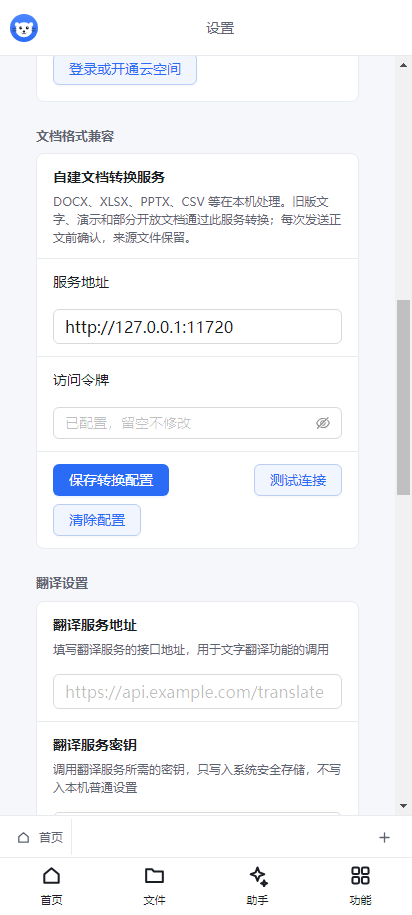

# 1.9.11 文档格式、CSV 保存与文件关联

CSV 打开后点击“保存”会写回 CSV，不再改成 XLSX。退出前保存使用同一套序列化规则。保留来源的中文编码、BOM、换行、空字段、前导零和引号内换行；公式、样式等不能写入分隔文本时要求确认，多工作表拒绝转换为单个 CSV。新增 TSV 同样执行这些规则。

Windows 默认程序注册、文件选择、拖入和命令行打开统一覆盖 50 种办公扩展名，包含旧式 DOC/XLS/PPT、Office 模板、宏正文、OpenDocument、MHTML、XML、DBF/PRN/DIF/SLK 和 OFD。Windows 安装版、便携版及 MSIX 包均内置离线兼容引擎；宏、加载项和不能完整回写的来源要求另存普通格式。OFD 提供阅读、打印、原样副本与 PDF 导出。

移动端同步全部 50 种扩展名，常用 DOCX/XLSX/PPTX、CSV/TSV、旧表格、OOXML 模板与宏正文、MHTML、PDF/OFD 在本机处理；旧文字、演示和部分开放格式通过用户配置的自建服务转换。设置中心提供服务地址、加密访问令牌、保存配置、测试连接和清除配置；上传正文逐次确认，更换服务地址不自动复用旧令牌。设备导出失败保留应用内的原文件和来源指纹，允许重试。

完整格式清单、保存范围、移动端差异与许可证见 [文档格式支持](文档格式支持.md)。本轮没有加入图片、压缩包、CAD、XMind 或 WPS 专属格式。已确认的两套界面图标、PC 扁平主题及默认 150% 缩放继续保留。

自建服务提供独立 Node 服务、Docker 配置、HTTPS 反向代理示例和 [DocumentConverter 部署包](https://github.com/fangzhouxiaohai/seal-office/releases/download/v1.9.11/SealOffice1.9.11-DocumentConverter.zip)。转换服务已部署到本项目管理后台，正式接口为 https://seal.xingmasoft.com/api/office-converter，可在后台查看运行状态、控制并发和管理令牌。手机在设置中心填写接口地址及后台生成的令牌，使用方法见[部署与验收](后台文档转换部署与验收.md)。

## 验收记录

验证使用自行生成的中文、前导零和数值样本，不读取用户截图中的凭据文件。结果及包体摘要见[验收汇总](verification/v1.9.11/summary.json)，逐项原始记录与测试方法随源码保存。

| 验收范围 | 结果 |
| --- | --- |
| 主进程自动化 | 90 个文件、921 项全部通过 |
| 渲染层自动化 | 全量 203 个文件、1,848 项中 1,847 项通过；OFD canvas 回归修复后，最终受影响的 6 个文件、82 项全部通过；全量未再次运行，原始失败与复测计数在[测试摘要](verification/v1.9.11/test-summary.json)分别记录 |
| 移动单元 / 服务 / 包装清单 | 11 / 3 / 2 项全部通过；桌面和移动类型检查通过 |
| 实际旧格式、模板、开放格式与 XML | 39 组通过；早期样本报告保留版本升级前的 1.9.10 元数据，1.9.11 成品另验证真实 DOC 读取、写回二进制和重开 |
| 移动兼容格式 | 37 组读取、25 组保存重开、服务配置和设置页合计 64 条流程通过；实际鉴权转换服务参与验收 |
| 移动网页 / 本地 WebView 宿主模拟 | 两种加载方式各 18 组通过，包含图片操作、全部功能入口、存储恢复和设备导出失败保护 |
| OFD | 两页中文与图形渲染、原字节副本、移动 PDF 导出和 Electron 打印通过，核对实际纸张尺寸及像素内容 |
| Windows 文件关联 | 隔离注册表 284 项通过，50 种扩展名注册；不修改真实受保护的 UserChoice |
| Windows 成品 | 解包版、便携版各三次启动正常退出，各 63 项通过；实际打包模块 8 组格式与打印检查通过 |
| 安装版 / 便携版包体 | 内嵌 app.asar 和关键转换引擎文件与验收后的解包版一致，105 个应用文件通过完整性检查 |
| MSIX | 19,577 个包内文件逐项核对哈希，50 种扩展名登记核对；用于商店上传的未签名包，未执行本机安装或商店上传 |
| 安卓资源、H5、UTS | 1.9.11 本地编辑器资源和 H5 构建通过，HBuilderX 5.26 UTS/Kotlin 与静态资源检查通过 |

首轮移动格式测试完成全部 63 条格式与服务配置检查后，测试脚本误选不存在的设置入口；已修正导航并重新运行全部兼容读取及设置页操作。原始失败报告与最终报告均保留在[移动格式验收](verification/v1.9.11/mobile-formats.json)，没有把首次运行改写为通过。

Android 同步源码及本地资源，版本为 1.9.11、versionCode 10911，默认打包命令仍只针对 Android。用户提供的新版云 APK 已完成包体核验并上传，核验详情见下方发布补充。各厂商真机、Android 9–16、iOS 和鸿蒙兼容性仍需相应设备验证；现有 Android 14 模拟器中的旧 APK 结果不能代替本版真机验收。

高级排版、图表、动画和专有对象仍受编辑器能力约束；宏与加载项只导入正文，要求另存普通格式，不承诺无损回写。PDF/A 输入可阅读，编辑后输出普通 PDF；OFD 为阅读、打印、原样副本或 PDF 导出。具体边界以格式清单为准。

## Android / Ubuntu 发布补充

1.9.11 最新云 APK 已核验并上传，签名与旧包一致，内置编辑器与当前安卓资源构建一致；Android 9–16 配置、ARM 双 ABI、ELF 与 ZIP 的 16 KB 对齐均通过。新 APK 原生交互验收仍待设备连接，具体记录见 [云包核验](verification/v1.9.11/android-cloud-apk.json)。

新增 Ubuntu amd64 安装包、Linux 文件打开与默认关联、本地旧格式转换及随包中文字体。Ubuntu 22.04、24.04 各通过 71 项实际安装包检查，包含默认关联按钮点击、文档转换往返、中文 PDF 和正常退出；同一个包体的 SHA-256 与两个原始报告一致，见 [发布核验](verification/v1.9.11/ubuntu-release.json)。安装和验证范围见 [Ubuntu 版说明](Ubuntu版安装与发布.md)。新增平台后主进程 925 项、关联弹窗 10 项、构建清单 2 项检查通过，见 [平台单元检查](verification/v1.9.11/platform-unit-tests.json)。

按用户要求移除 54 个历史 Windows 安装包、12 个旧校验附件及 20 个仅含旧 Windows 资料的发布记录，只保留 1.9.11 安装版、便携版与 MSIX；教程、宣传和商店素材继续保留。Git 标签和源码历史未删除，当前补充源码另提供 Source.zip。清理结果见 [Windows 发布清理记录](verification/v1.9.11/windows-release-cleanup.json)。
